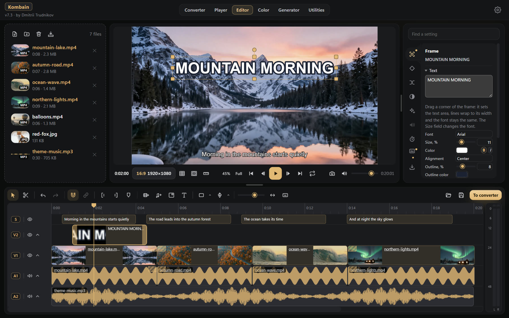
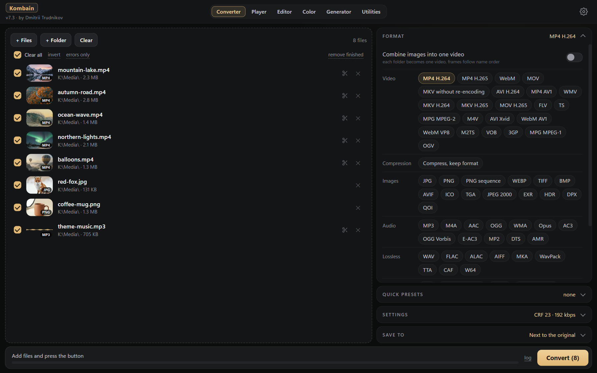
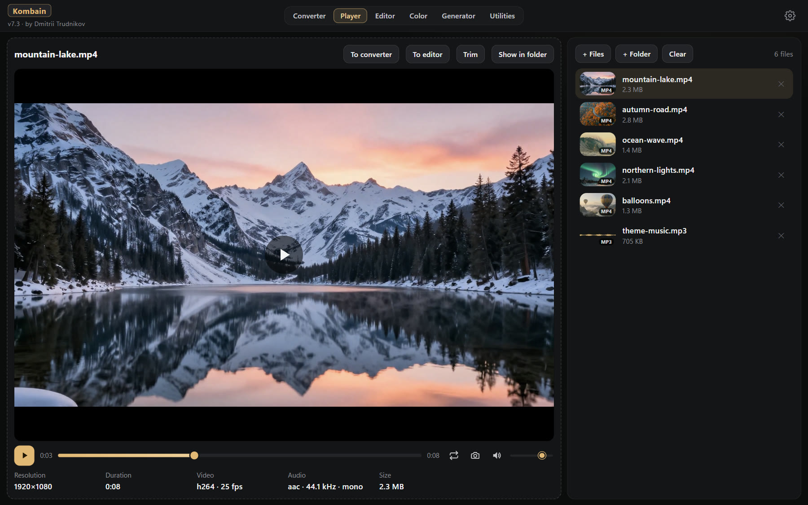
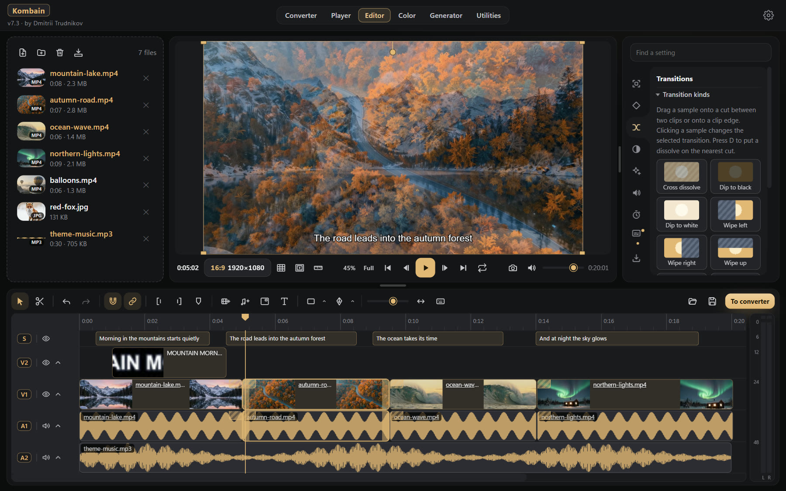
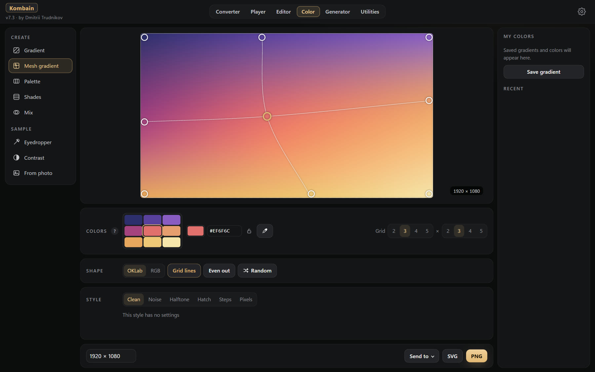
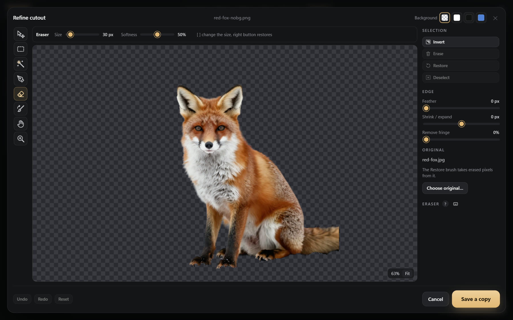
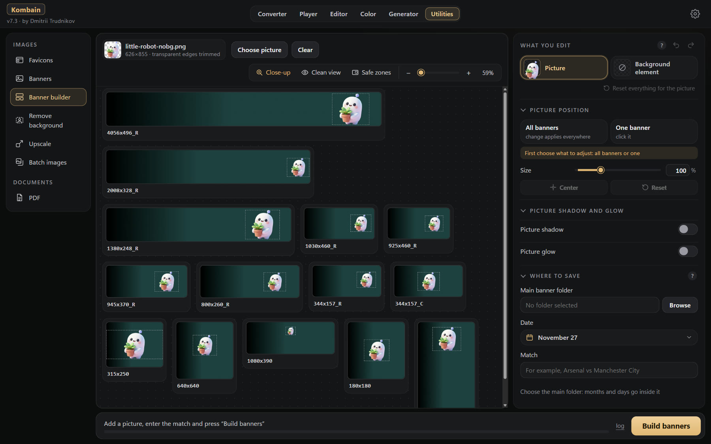
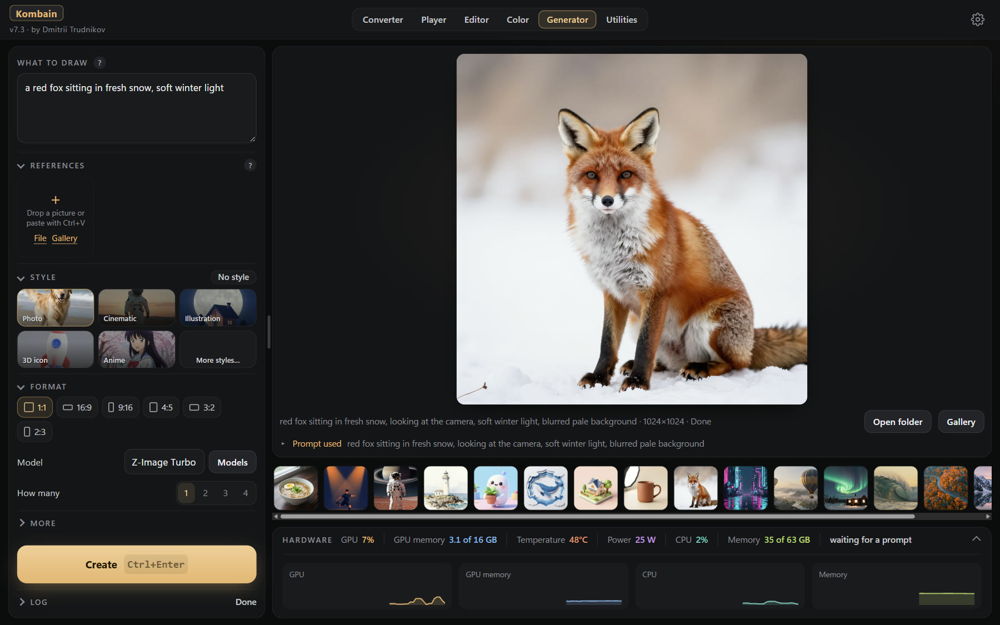
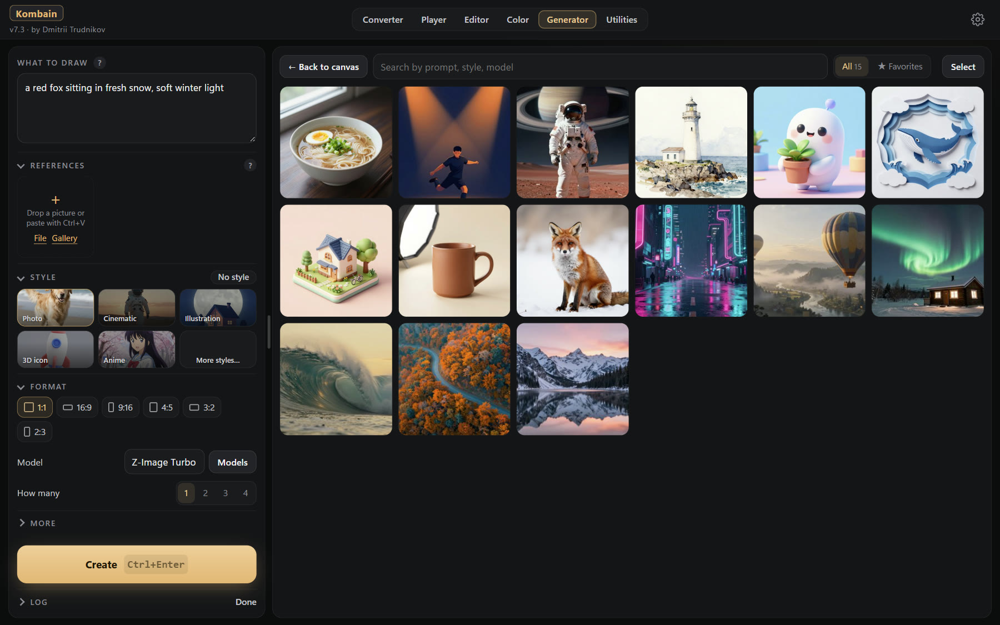

<div align="center">


# Kombain

**Converter, player, video editor, color tools, utilities and an image generator in one Windows app**

[](https://github.com/RockyRoketto/Kombain/releases/latest)


### [⬇ Download Konvertor.exe](https://github.com/RockyRoketto/Kombain/releases/latest/download/Konvertor.exe)

[Русский](README.md) · **English** · [What's new](CHANGELOG.en.md)

</div>



Drop files or a folder into the window, pick a format and press "Convert". When that is not enough, there is a multitrack editor, a player, tools for color and images, and a generator that draws on your own GPU. All of it is a single exe built on ffmpeg, with the interface in English and Russian.

[Getting started](#getting-started) · [Converter](#converter) · [Player](#player) · [Editor](#editor) · [Color](#color) · [Utilities](#utilities) · [Image generator](#image-generator)

## Getting started

1. Download `Konvertor.exe` and run it (Windows 10 or 11). If Windows says "Unknown publisher" (the exe is not code-signed), click "More info" → "Run anyway".
2. The app offers to install itself (Start menu, "Send to"). You can also work without installing.
3. The app downloads ffmpeg by itself (about 100 MB, once).
4. For the image generator it checks your hardware and downloads a model (about 10 GB, once).

Theme, language and settings are behind the gear icon in the top right.

**Learning.** Every tab has a short tour that highlights the right spots and explains them step by step; it starts by itself on your first visit. New features carry an orange "New" badge, and less obvious ones a green "!" with a hint. You can replay every tour in the settings, under "Learning", and the "Show new" button in the "What's new" window walks through just the fresh features.

## Features

### Converter

90+ output formats: MP4 (H.264, H.265, AV1), WebM, MOV, MKV, editing formats (ProRes, DNxHR), photos (JPG, PNG, WEBP, AVIF and more), GIF and animated WEBP, audio (MP3, AAC, Opus, FLAC, WAV and more).

- Compress to a target size in MB (for email, say); quality is picked automatically.
- Frame-accurate trimming, ready-made and custom presets, up to 4 files at once.
- The original is never changed: by default the result is saved next to it.
- Video to PNG sequence and back, fine control of codec, CRF, FPS and bitrate.



### Player

Watch and listen right in the app: one file or a whole folder, with the queue on the right.

- Drag to reorder the queue.
- Save a frame as PNG in one click.
- Send the open file to the converter, trimming or the editor.
- Formats the window cannot play itself (ProRes, for example) are prepared for viewing.



### Editor

A timeline desk: files on the left, preview in the center, inspector on the right, tracks below.

- Clips sit freely: move, cut, copy, up to 100 undo steps. Video with sound is placed as a linked pair.
- Text and shapes (rectangle, ellipse, line, arrow, Bézier pen), transitions between clips.
- Keyframes with easing curves, ready-made animations, speed 0.25–8×, reverse.
- Color correction and chroma key, blur, shadow, blend modes, audio with a level meter.
- Subtitles from speech (whisper.cpp, works offline), line editing, effects such as Karaoke, Typewriter, Glitch and ready-made styles.
- Sizes for Full HD, 4K, 9:16, square, 4:5, safe zones for Reels, Shorts and TikTok. Projects are saved as `.kb`; after a crash the app offers to restore it.



### Color

Gradients, palettes and everything you need to pick and check a color.

- Linear, radial and conic gradients with OKLCH blending, plus mesh gradients.
- Palettes built on color-wheel rules, a 50–950 shade scale.
- An on-screen eyedropper and colors from a photo.
- WCAG contrast check.
- Export to PNG, SVG, CSS, JSON and ASE (Photoshop, Illustrator, InDesign).



### Utilities

Image and PDF tools you would otherwise hunt for across different websites.

- **Remove background** and **Upscale ×2 / ×4** with neural networks, transparency is kept.
- **Cutout editor** in the spirit of Photoshop: marquee, magic wand, pen, eraser and restore brush, feathering and fringe removal. The original stays as it was.
- **Banners** and **Banner builder:** one picture is placed on all 14 templates inside its safe zone, with a background element, shadow and glow.
- **Favicons:** a full website set from one icon, with `site.webmanifest` and a ready `head.html`.
- **Batch images:** size, format, metadata removal and a watermark for a whole pile.
- **PDF:** images to PDF, compress to a target size, merge and split, repair, watermark, page numbers, AES-256 password.





### Image generator

Text-to-image on your own computer: offline, no subscriptions and no limits.

- Models: FLUX.2 klein (default), Z-Image Turbo, SDXL, Qwen-Image, ERNIE-Image, Chroma1-HD. Downloads resume and files are verified.
- Write your request in Russian or English: the assistant rewrites it into a detailed English prompt that you can edit. Flags and countries are drawn in their real colors.
- 39 styles with sample pictures, including "Sports banner" and "Sports 3D", and up to 8 references with roles "Base", "Style", "Character".
- Gallery with search and favorites, variations, "Repaint a part", "Outpaint", "Remove background", "Upscale".
- Settings are stored inside the PNG: drop the picture back and the fields fill in.

The generator needs an NVIDIA, AMD or Intel GPU with 4 GB+ of video memory (8 GB is comfortable); all other tabs run on any PC.





## For developers

A single Go exe: a local server and a WebView2 window with the UI from `web/`. Code map: [docs/MAP.md](docs/MAP.md).

```powershell
$env:GOOS='windows'; $env:CGO_ENABLED='0'; go build -trimpath -ldflags "-s -w -H=windowsgui" -o Konvertor.exe .
```

Checks: `gofmt -l .` is empty, `go test ./...`. Release: `release.cmd X.Y`, then GitHub Actions builds it.

---

<div align="center">

© Dmitrii Trudnikov

</div>
