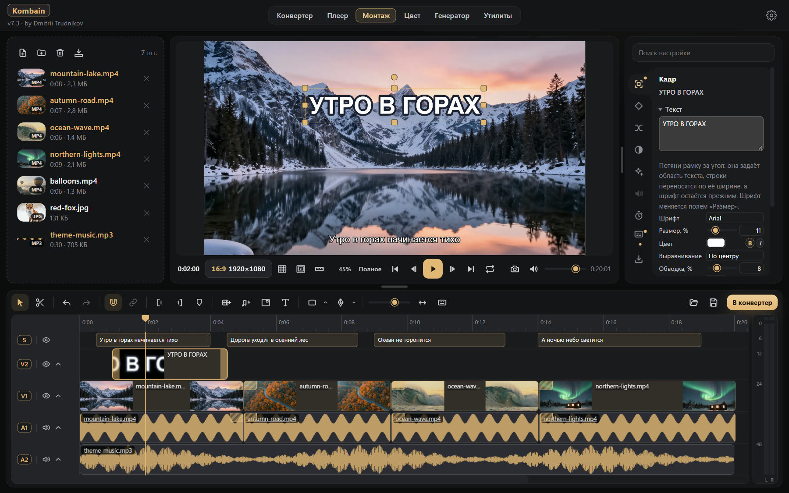
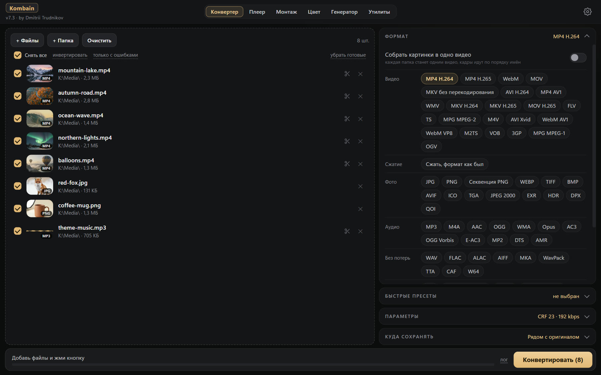
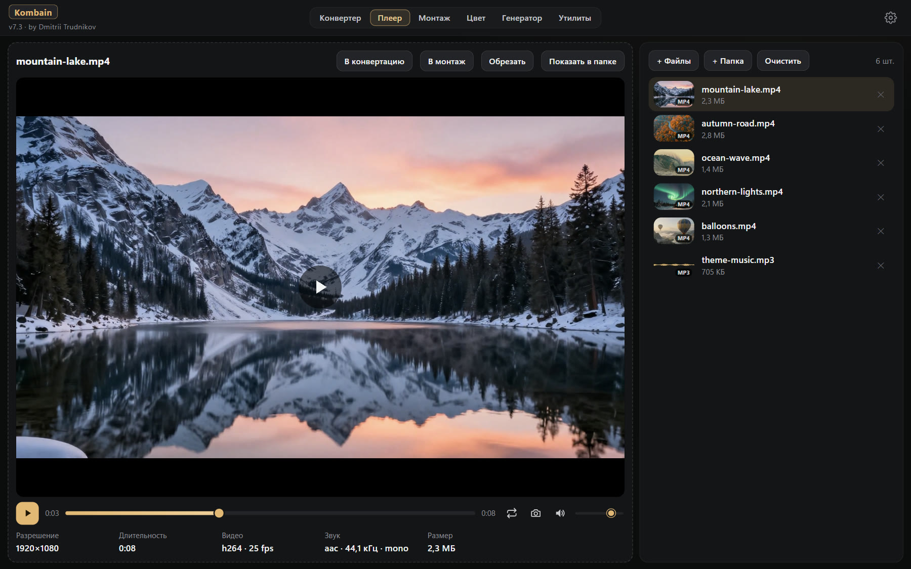
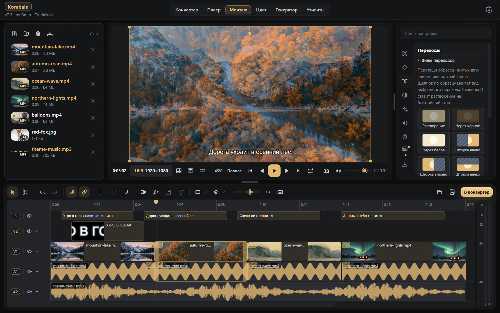
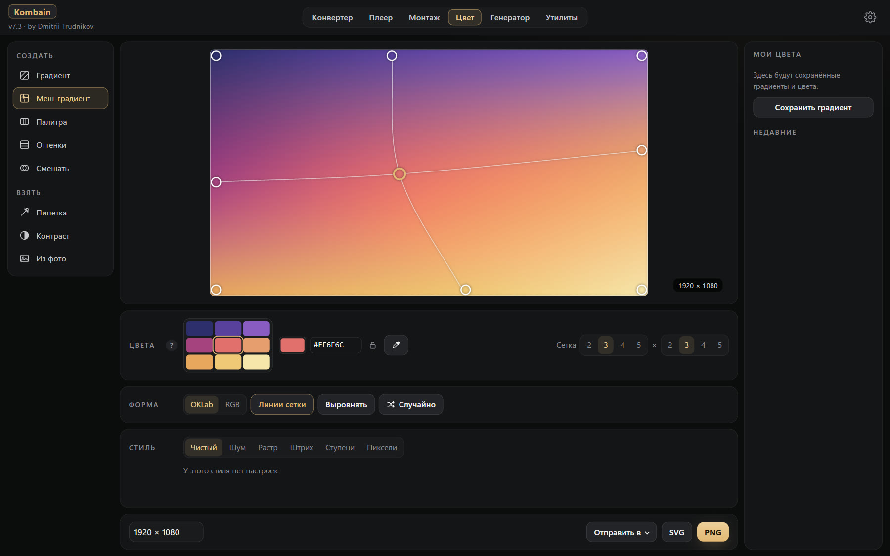
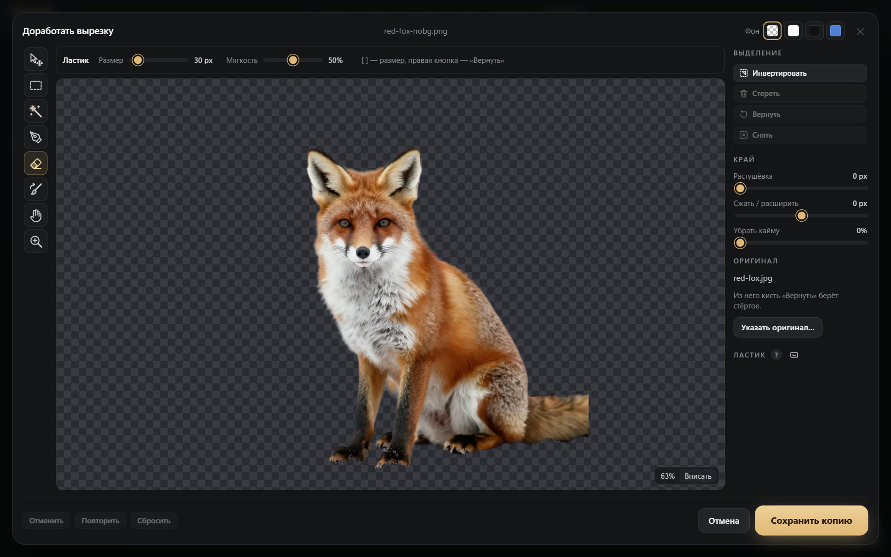
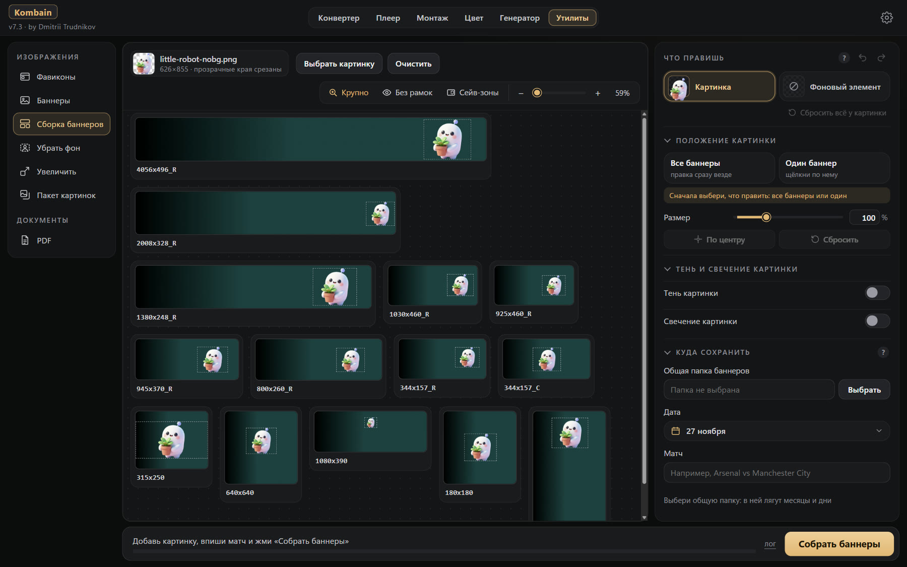
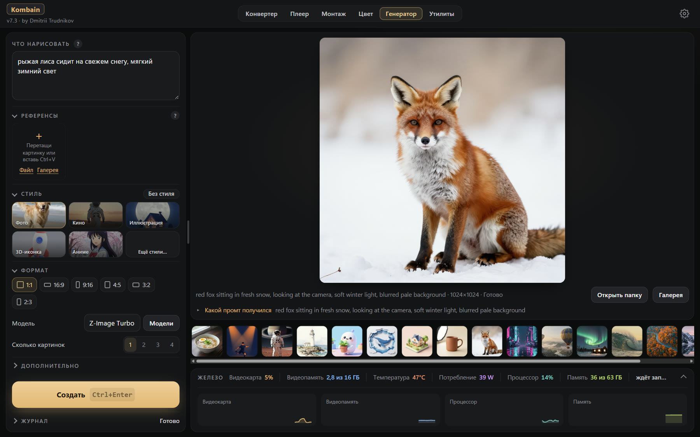
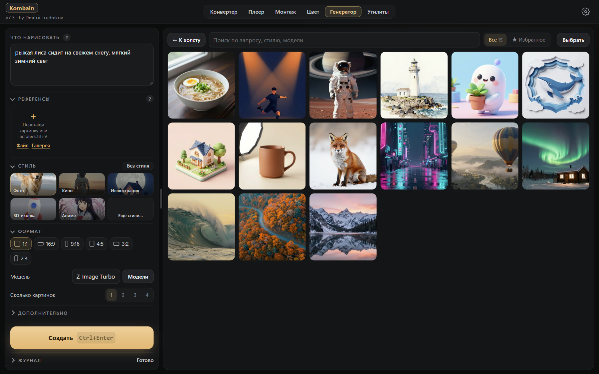

<div align="center">


# Kombain

**Конвертер, плеер, монтаж, цвет, утилиты и генератор картинок в одной программе для Windows**

[](https://github.com/RockyRoketto/Kombain/releases/latest)


### [⬇ Скачать Konvertor.exe](https://github.com/RockyRoketto/Kombain/releases/latest/download/Konvertor.exe)

**Русский** · [English](README.en.md) · [Что нового](CHANGELOG.md)

</div>



Перетащи файлы или папку в окно, выбери формат и нажми «Конвертировать». А когда этого мало, рядом монтажный стол, плеер, инструменты для цвета и картинок и генератор, который рисует на твоей видеокарте. Всё это один exe на ffmpeg, интерфейс на русском и английском.

[Как начать](#как-начать) · [Конвертер](#конвертер) · [Плеер](#плеер) · [Монтаж](#монтаж) · [Цвет](#цвет) · [Утилиты](#утилиты) · [Генератор картинок](#генератор-картинок)

## Как начать

1. Скачай `Konvertor.exe` и запусти (Windows 10 или 11). Если Windows пишет «Неизвестный издатель» (у exe нет цифровой подписи), нажми «Подробнее» → «Выполнить в любом случае».
2. Программа предложит установиться (меню «Пуск», «Отправить»). Можно работать и без установки.
3. ffmpeg программа скачает сама (около 100 МБ, один раз).
4. Для генератора картинок откроется проверка железа и загрузка модели (около 10 ГБ, один раз).

Тема, язык и настройки за шестерёнкой справа вверху.

**Обучение.** На каждой вкладке есть короткий тур: подсвечивает нужные места и объясняет по шагам, запускается сам при первом заходе. Новые возможности помечены оранжевым значком «Новое», а непонятные — зелёным «!» с подсказкой. Все туры можно пройти заново в настройках, в разделе «Обучение», а кнопка «Показать новое» в окне «Что нового» покажет только свежие функции.

## Возможности

### Конвертер

Больше 90 форматов вывода: MP4 (H.264, H.265, AV1), WebM, MOV, MKV, форматы для монтажа (ProRes, DNxHR), фото (JPG, PNG, WEBP, AVIF и другие), GIF и анимированные WEBP, звук (MP3, AAC, Opus, FLAC, WAV и другие).

- Сжатие до нужного размера в МБ (например, для почты), качество подбирается само.
- Обрезка с точностью до кадра, готовые и свои пресеты, до 4 файлов одновременно.
- Оригинал не меняется: по умолчанию результат ложится рядом с ним.
- Видео в секвенцию PNG и обратно, тонкая настройка кодека, CRF, FPS и битрейта.



### Плеер

Смотри и слушай прямо в программе: файл или целая папка, очередь справа.

- Порядок в очереди меняется перетаскиванием.
- Кадр в PNG одной кнопкой.
- Открытый файл отправляется в конвертер, обрезку или монтаж.
- Форматы, которые окно не играет само (например, ProRes), программа готовит к просмотру.



### Монтаж

Монтажный стол: файлы слева, превью по центру, инспектор справа, дорожки внизу.

- Клипы лежат свободно: двигать, резать, копировать, отмена до 100 действий. Видео со звуком встаёт связанной парой.
- Текст и фигуры (прямоугольник, эллипс, линия, стрелка, перо Безье), переходы на стыках клипов.
- Ключевые кадры с кривыми, готовые анимации, скорость 0,25–8×, реверс.
- Цветокоррекция и хромакей, размытие, тень, режимы наложения, звук с индикатором громкости.
- Субтитры из речи (whisper.cpp, работает без интернета), правка реплик, эффекты «Караоке», «Печатная машинка», «Глитч» и готовые стили.
- Размеры под Full HD, 4K, 9:16, квадрат, 4:5, безопасные зоны Reels, Shorts и TikTok. Проект сохраняется в `.kb`, после сбоя программа предложит его вернуть.



### Цвет

Градиенты, палитры и всё, что нужно, чтобы подобрать и проверить цвет.

- Градиенты линейные, круговые и конические со смешиванием в OKLCH, меш-градиенты.
- Палитры по правилам круга оттенков, шкала оттенков 50–950.
- Пипетка с экрана и цвета из фото.
- Проверка контраста по WCAG.
- Выгрузка в PNG, SVG, CSS, JSON и ASE (Photoshop, Illustrator, InDesign).



### Утилиты

Инструменты для картинок и PDF, которые обычно ищут по разным сайтам.

- **Убрать фон** и **Увеличить ×2 / ×4** нейросетями, прозрачность сохраняется.
- **Редактор вырезки** в духе Фотошопа: рамка, волшебная палочка, перо, ластик и «Вернуть», растушёвка и удаление каймы. Оригинал остаётся как был.
- **Баннеры** и **Сборка баннеров:** одна картинка встаёт на все 14 шаблонов в свою сейв-зону, с фоновым элементом, тенью и свечением.
- **Фавиконы:** из одной иконки весь набор для сайта с `site.webmanifest` и готовым `head.html`.
- **Пакет картинок:** размер, формат, удаление метаданных и водяной знак для целой пачки.
- **PDF:** картинки в PDF, сжатие до размера, склейка и разрезание, починка, водяной знак, номера страниц, пароль AES-256.





### Генератор картинок

Картинки по тексту прямо на твоём компьютере: офлайн, без подписок и лимитов.

- Модели FLUX.2 klein (по умолчанию), Z-Image Turbo, SDXL, Qwen-Image, ERNIE-Image, Chroma1-HD. Скачивание с докачкой и проверкой файлов.
- Пиши запрос по-русски: помощник перепишет его в подробный английский промт, а ты сможешь его поправить. Флаги и страны рисуются в настоящих цветах.
- 39 стилей с картинками-примерами, в том числе «Спорт-баннер» и «Спорт 3D», и до 8 референсов с ролями «Основа», «Стиль», «Персонаж».
- Галерея с поиском и избранным, вариации, «Перерисовать часть», «Дорисовать за краями», «Убрать фон», «Увеличить».
- Настройки записаны внутри PNG: перетащи картинку обратно, и поля заполнятся.

Для генератора нужна видеокарта NVIDIA, AMD или Intel от 4 ГБ (удобно от 8), остальные вкладки работают на любом ПК.





## Для разработчиков

Один exe на Go: локальный сервер и окно WebView2 с интерфейсом из `web/`. Карта кода: [docs/MAP.md](docs/MAP.md).

```powershell
$env:GOOS='windows'; $env:CGO_ENABLED='0'; go build -trimpath -ldflags "-s -w -H=windowsgui" -o Konvertor.exe .
```

Проверки: `gofmt -l .` пусто, `go test ./...`. Выпуск: `release.cmd X.Y`, дальше GitHub Actions собирает релиз.

---

<div align="center">

© Dmitrii Trudnikov

</div>
